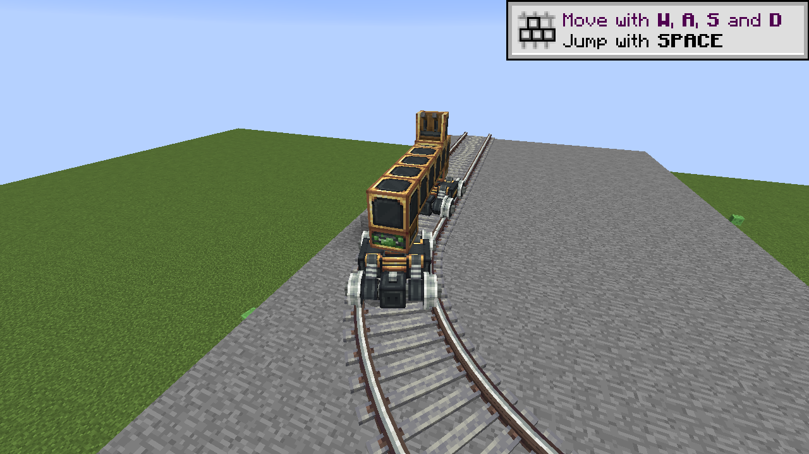
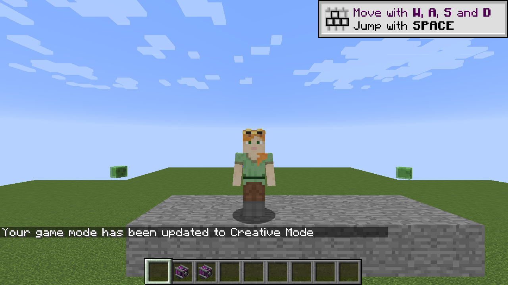

# Create 0.3.0 alpha validation

Checked in the cloud workspace on 2026-10-25 with Cleanroom 0.7.4-alpha, Minecraft 1.12.2 and Java 25. The client used Xorg's dummy display and llvmpipe software rendering. This is functional validation of the implemented slice, not complete Create/add-on or pixel-level parity certification.

## Build and independent checks

- `gradle --no-daemon build`: passed compilation, JAR packaging, reobfuscation and all **50 JUnit tests**; zero failures, errors or skips.
- `bash scripts/test-core.sh`: all 50 tests passed. Coverage includes kinetic networks, rail traversal, motion/braking, OBJ parsing, glue graphs, Wrench axis conventions/readouts, cubic Bezier geometry and Create's flat placement rules.
- Ten selected resources compared byte-for-byte with the supplied Create 6.0.8 JAR: the Track item JSON and icon, both Train Casing textures, rail/tie meshes, the virtual controls model and the Wrench/Goggles item textures. Original upstream notices are included in META-INF.

## Native server and client

- Dedicated server loaded Create and an existing development world. Six live kinetic assertions passed for powered/unpowered shafts, reversal and disconnection. Motor settings and the disconnected shaft survived restart.
- The existing block-track train fixture passed 13 assertions for registration, shape connections, acceleration, route retention, corners, coasting, reverse and end-of-track stopping. All seven cursor/control fields survived restart.
- Real Train Station item clicks selected a straight rail and placed/configured the station. Its GUI entered assembly mode. Real Train Casing clicks placed two bogeys.
- Real Super Glue clicks connected a six-block Train Casing deck and Train Controls. The station captured **nine world blocks** (including two bogeys), removed the source blocks and created a saved carriage palette. The client rendered original casing/bogey assets and the opened console model.
- A player mounted the actual controls, drove and braked. Punching did not remove the carriage. Ordinary body clicks did not mount a world-built train.
- A blocked destination refused disassembly and retained the entity. After clearing that block, station disassembly restored all nine world blocks and six saved glue bonds. Those blocks assembled again without re-gluing.
- Real Track item clicks placed a flat Bezier turn with default straight extensions. Saved endpoints were `(50,8,30.5)` and `(57.5,8,38)`, anchored at `(49,8,30)` and `(57,8,38)`. The original rail/tie meshes rendered through the turn.
- The world-built two-bogey carriage drove onto this curve, changed body heading and stopped. The connection, nine-block palette and stopped curve distance `9.1` survived restart.
- A separately summoned long-carriage fixture tested interaction reach: a body click did not mount; actual controls eleven blocks from the rear bogey did mount and accepted driving/braking. This fixture tests the interaction adapter, not world-block assembly.
- Wrench rotation changed a motor from east to down while retaining **64 RPM**. Survival Sneak-use removed it and returned a motor item with `BlockEntityTag.GeneratedRPM=64`.
- Goggles use equipped the head slot and returned the previous iron helmet to the hand. Their worn model rendered on the forehead. Looking at a native motor displayed **32 RPM, 524,288 SU capacity, zero stress** from synchronized server data.
- A powered dispenser equipped Goggles on an armor stand.

## Development notes and remaining limits

Manual fixture areas are documented in the environment start instructions; the prepared world/configuration remain ignored. No reference JAR is installed as a runtime dependency. Server and RCON tests bind to loopback. Online authentication is restored after offline development-client checks.

The Cleanroom development console still reports its JLine class-loader error; use local RCON for functional commands and graceful shutdown. A separate SDL splash/transformer race was avoided by disabling the splash in ignored client configuration. Software rendering and concurrent server work occasionally produced low frame rate/server lag; this is not a performance-parity benchmark.

[The train guide](TRAINS.md), [track maths](TRACK-MATH.md), [equipment guide](EQUIPMENT.md) and [parity table](PARITY.md) describe the current behavior and remaining gaps: connected carriages, schedules/signals, seats, full contraption actors, complete slope/junction placement, paving/girders and add-ons are not implemented. Glue input and HUD/GUI details remain native compatibility adapters.

## Native screenshots

