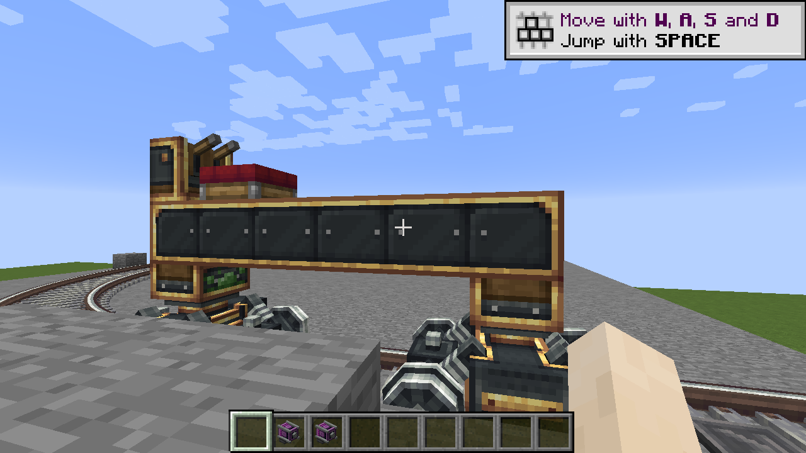
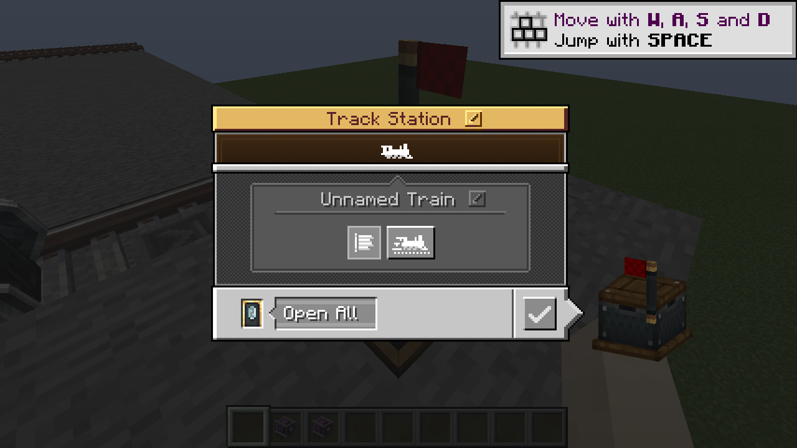
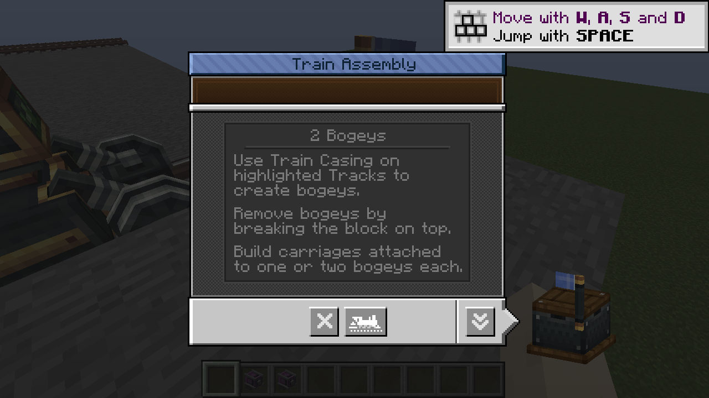
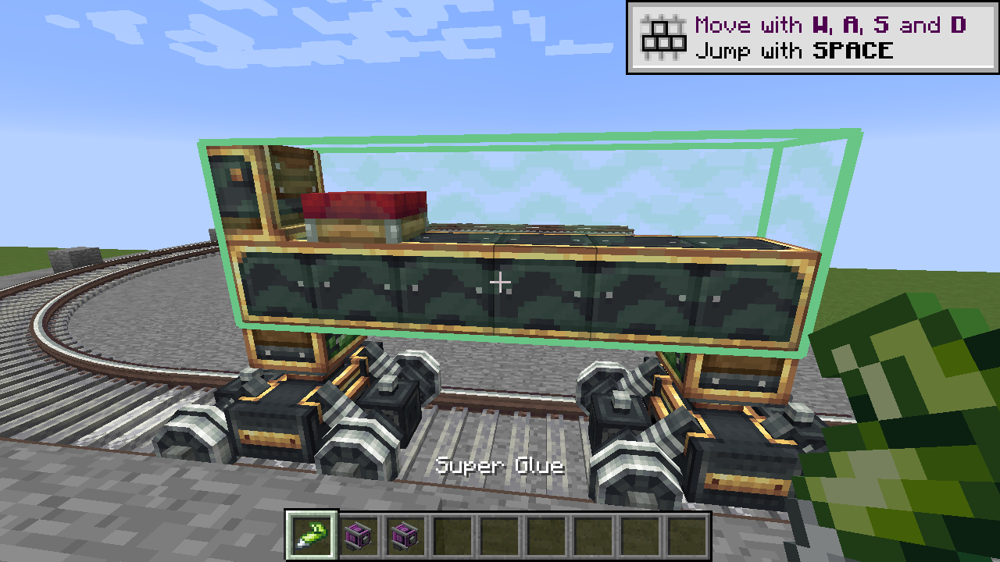
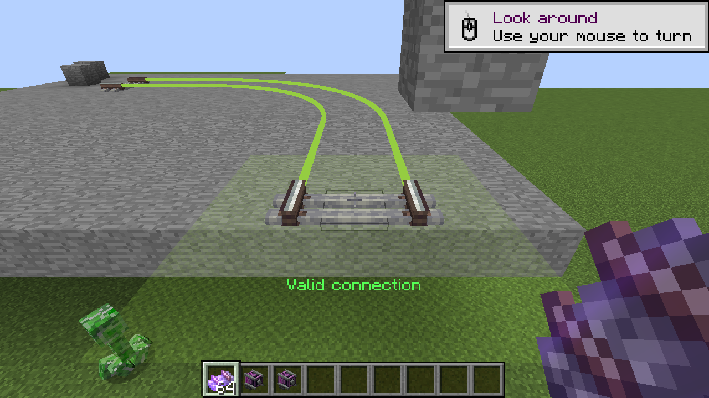
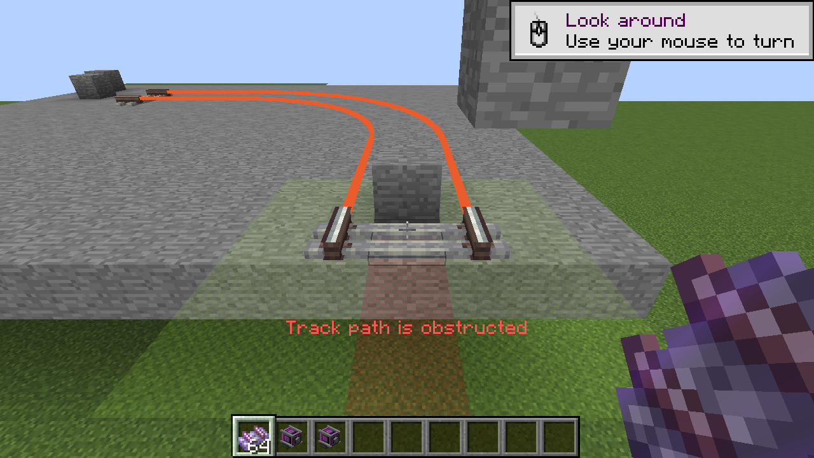
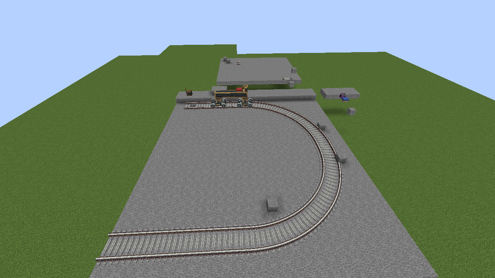
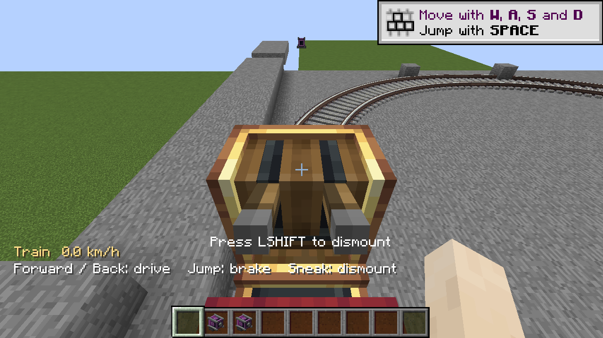
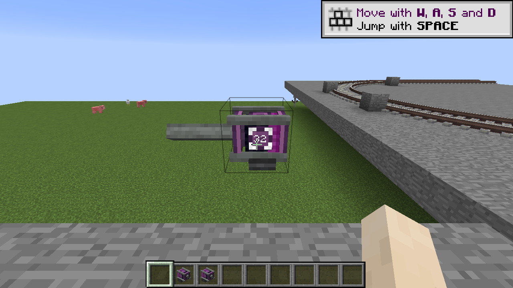
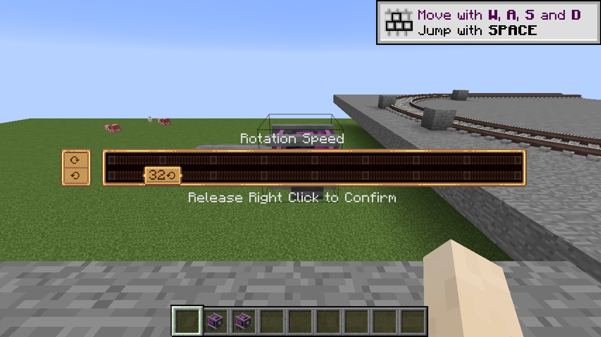

# Create 0.4.0 alpha validation

Target: Minecraft 1.12.2, Cleanroom 0.7.4-alpha and Java 25. Native checks used a loopback dedicated server and an Xorg/llvmpipe client. The supplied Create 6.0.8 assets and source are the reference. These results cover the implemented features; they do not certify complete Create/add-on or pixel-level parity.

## Build and package

- `gradle --no-daemon build`: compilation, packaging, reobfuscation and **58 JUnit tests passed**, with zero failures, errors or skips.
- `bash scripts/test-core.sh`: the same 58 independent tests passed. New coverage checks all connected-texture neighbor masks, corner gating, bounded glue connectivity and two-quarter-turn half-circle connectivity.
- Fourteen selected original assets matched the supplied JAR byte-for-byte: station/assembly/widget/icon atlases, connected casing sheets, glue/checkerboard textures, red seat block/item models, station flag/overlay models and Track item model/icon.
- Packaged metadata is 0.4.0-alpha. All 16 seat item models and the new seat/renderer classes are present. The prototype Train Carriage item class/model is absent. Upstream notices remain in META-INF. No modern reference mod JAR is bundled.

## Native interactions

- An existing world loaded with the removed prototype item remapped to Train Casing, without a missing-registry confirmation. Old trains and track connections remained readable.
- Real Glue clicks selected opposite corners spanning six casing deck blocks, a red seat and controls. The green selection and saved-volume outlines/face texture rendered. Left-click removed the saved area; two real corner clicks recreated it.
- Station assembly captured **10 original world blocks**, including both bogeys, the seat and controls. The source positions became air. The saved carriage included a local glue volume. Connected casing rendered in the world and in the moving palette, with no missing-model texture after correcting extended-state model lookup.
- Station screens used the original normal/assembly panels, icon buttons and flags. The assembly screen close button rendered its double-down glyph rather than the normal confirm glyph. Original source direction and assembly overlay models are included.
- A blocked restoration position retained the train. Clearing it and using the station restored the original bogeys, six deck blocks, seat, controls and saved glue volume at the station marker. The restored build assembled again without re-gluing.
- Clicking the carried seat set SeatIndex=7 and left ControlIndex=-1. Clicking its nearby actual controls, without teleporting or dismounting, activated ControlIndex=8 while keeping the passenger on that seat.
- That seated player accelerated with Forward across both quarter-turns of a real placed half-circle, stopped with Jump on the far straight, then reversed across both curves back toward the station. Server speed remained within 0.4 blocks/tick. Both bogeys stayed rail-supported.
- Real Track item clicks with Sprint held while stationary placed the half-circle's two maximized turns. The valid placement preview was green. A block placed into the proposed path changed the outline and affected hint cells to red/orange and reported the obstruction.
- A stationary blue seat spawned its invisible attachment and accepted a rider; Sneak dismounted while retaining the seat block.
- The motor showed its in-world **32** setting without the RPM information HUD when no Goggles were worn. Worn Goggles displayed synchronized **32 RPM / 524,288 SU capacity / zero stress**. Holding Use over the world value opened the original speed board and releasing confirmed. The rotating shaft remained gray after glue and track overlays rendered.
- The live kinetic regression passed all six assertions. The legacy rail-loop regression passed all 13 assertions for shapes, acceleration, multiple curves, coasting, reverse and end-of-track stopping.

## Save/restart and cleanup

After graceful server restart, both kinetic persistence assertions and all seven legacy train cursor/control assertions passed. The new train retained eight checked cursor/seat/control fields, its 10-block palette and its local glue volume. The station retained its track target and direction. The earlier world-built train on a saved Bezier curve also remained in the prepared world.

Online authentication was restored after the isolated offline client check. Server, client and display processes were stopped; the accepted EULA and ignored world/configuration were preserved. No credentials are included in the artifact or repository. Foundation's known development-console JLine issue remains; functional commands and shutdown used local RCON.

## Limits

See [the parity table](PARITY.md) and [train guide](TRAINS.md). This release supports one carriage and one passenger per train. Connected carriages, automatic schedules/signals, arbitrary inventories/machine actors, moving door actors, walking on trains, complete slope/junction placement and the referenced add-ons remain unfinished. Station door-mode selection is saved; it does not imply moving doors exist. Selected source assets and adapted layouts do not establish exact behavior for the whole original mod.

## Native screenshots

## Artifact

`create-0.4.0-alpha.jar`, 380445 bytes.

SHA-256: `5905c58891bde5b541a71c49f07c8da175d6a543c8d0b02b0fae1cc4160517a8`.
