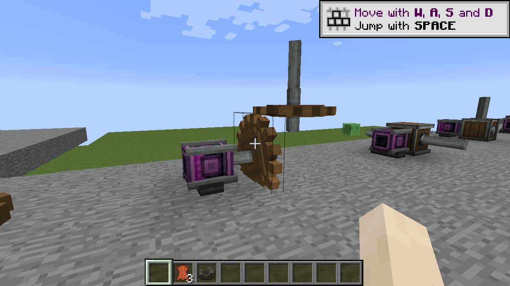
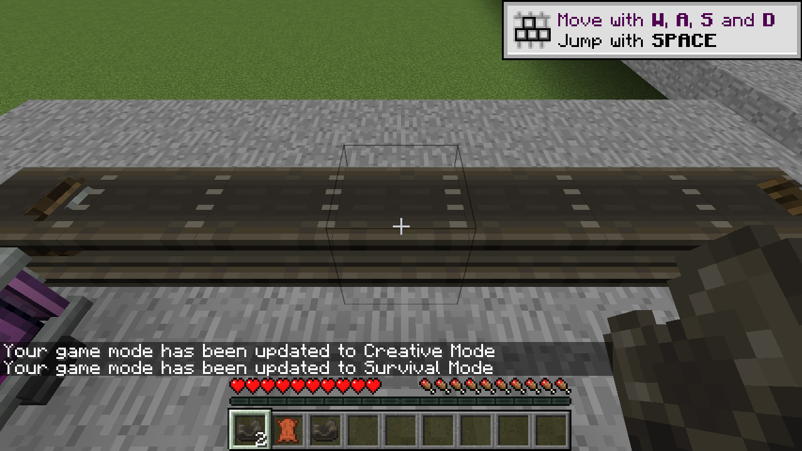
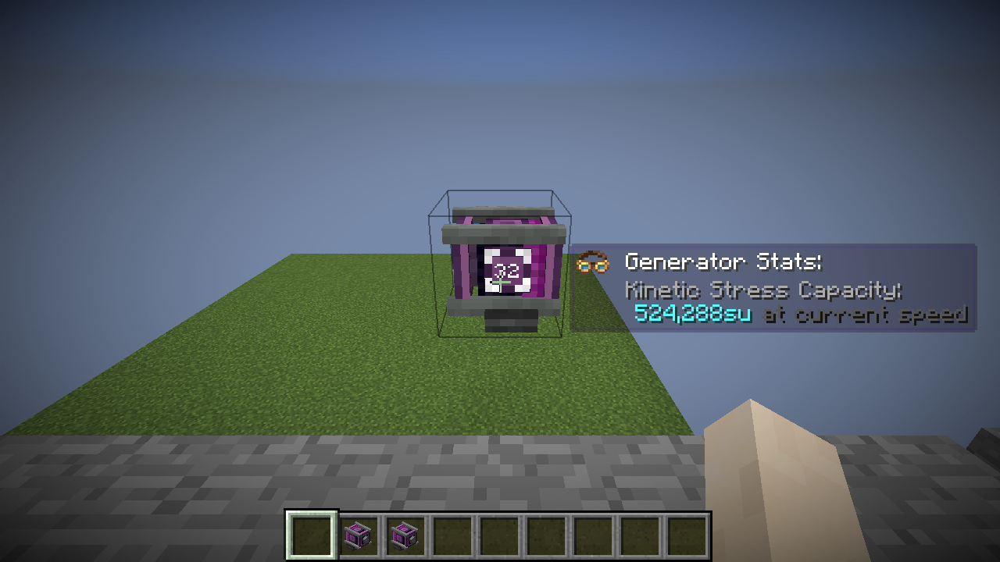
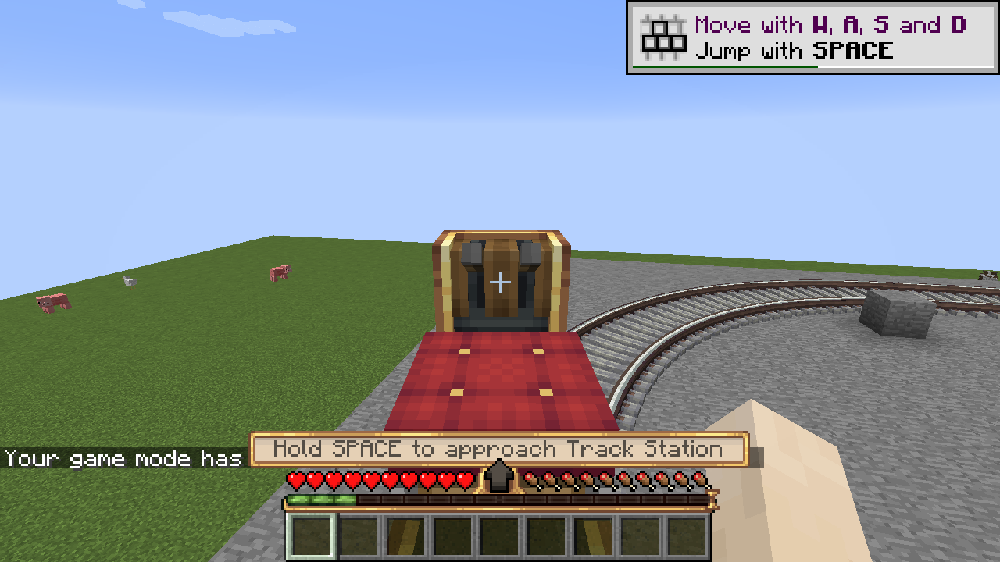
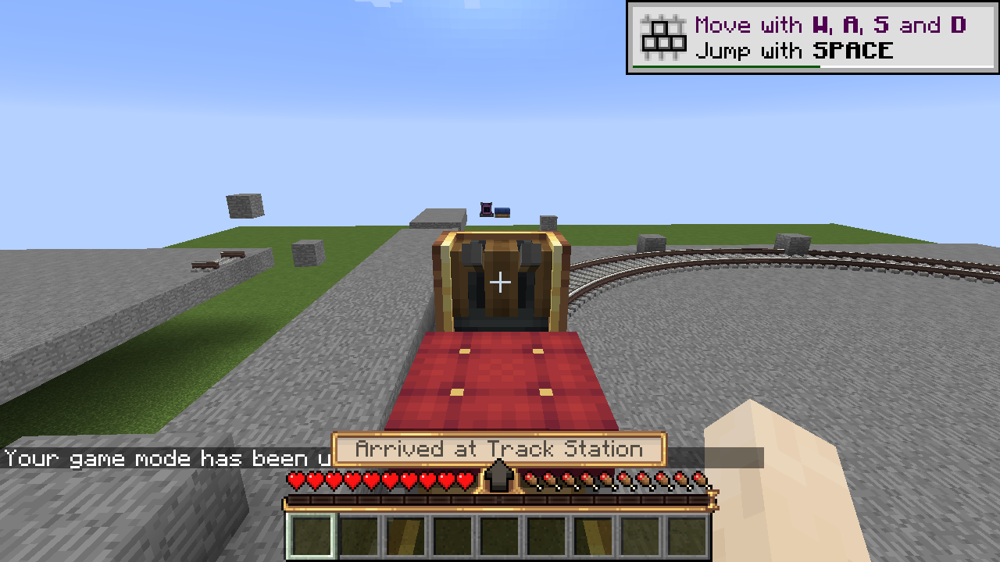
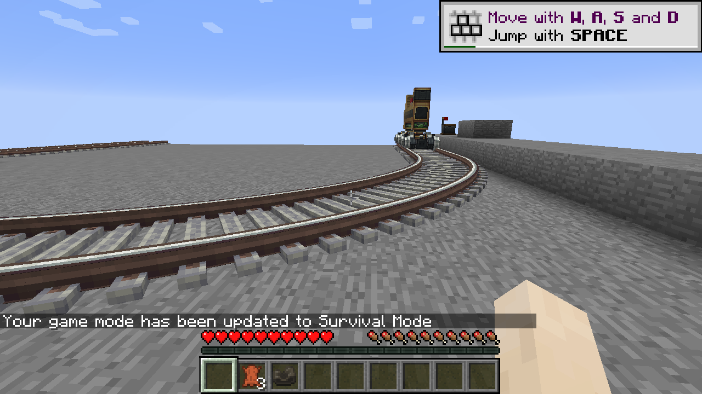
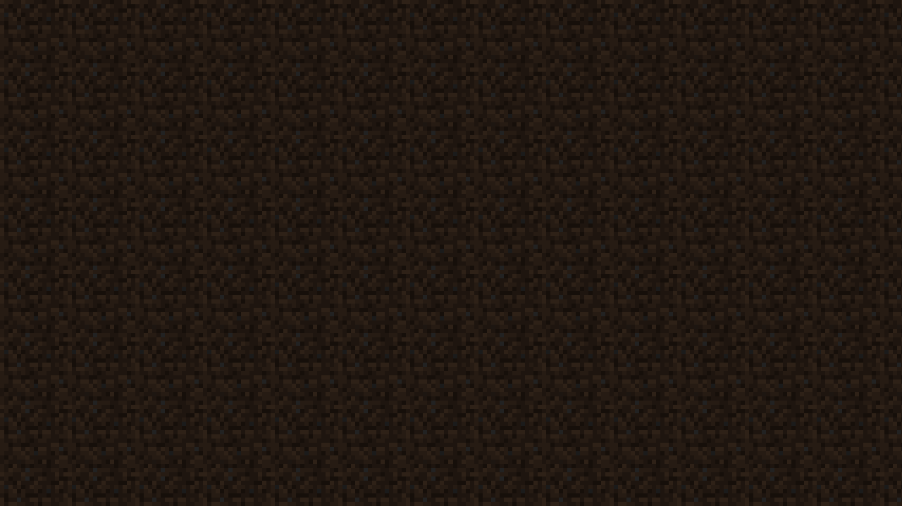
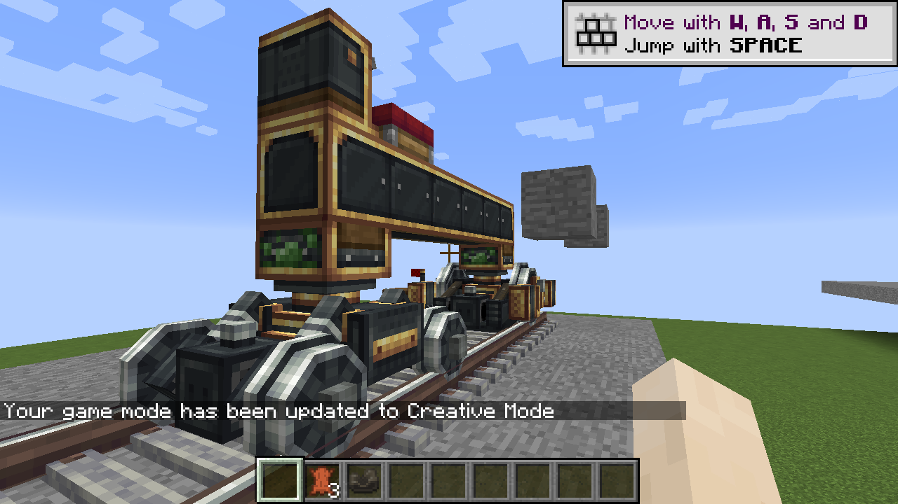

# Create 0.5.0 alpha validation

Target: Minecraft 1.12.2, Cleanroom 0.7.4-alpha and Java 25. Native checks used the prepared loopback dedicated server and an Xorg/llvmpipe client. Create 6.0.8 and the supplied JAR are the reference. These checks cover the implemented content; they do not establish complete Create/add-on or pixel-level parity.

## Build and resources

`gradle --no-daemon build` compiled, packaged and reobfuscated the mod. All **84 JUnit tests** passed, with zero errors, failures or skips. `bash scripts/test-core.sh` independently passed the same 84 tests. New coverage includes transmission ratios, belt geometry and direction independent of selection order, rotated collision footprints and discrete station stopping without overshoot.

Original selected cog, transmission, belt and large bogey assets are retained, with resource identifiers/vanilla log textures adapted to 1.12. All 240 byte-identical selected Create resources were compared with the supplied reference. The Ponder direction atlas matches the one embedded in the reference JAR. Notices identify the source. No modern Create/Ponder/add-on executable JAR is bundled. Metadata names one Create mod, version 0.5.0-alpha. There is no inventory Train Carriage item.

## Native transmissions

The live transmission regression passed all **17 assertions**: small gear reversal, large/small ratio, perpendicular large gears, gearbox face signs, vertical shaft outputs, clutch disengagement with the input half still turning, gearshift reversal, and adjustable chain ratios in both drive directions. The original six kinetic assertions also passed.

Real item placements passed all six motor directions, all three shaft axes (tested from six directions), and ordinary/vertical gearbox item orientation. Real Hand Crank clicks generated +32 and -32 RPM; both decayed to zero after release. The compact worn-Goggles generator tooltip rendered with its original icon and capacity styling.

Real belt clicks connected two parallel shafts, synchronized all seven segments to 64 RPM and carried an iron ingot. Survival consumed exactly one connector. Real Sneak-Wrench pickup removed the belt and restored both other pulley shafts. A removal callback initially exposed the already-replaced block state; removal now disconnects the full line before neighbor propagation, and ignores obsolete tile/port references. The corrected pickup/reconnection check passed.

## Native trains

- Real Train Casing clicks created a small bogey and cycled Small/Large through the adjacent rail. A second small bogey, six casing blocks, a seat and controls were joined with real Glue clicks. The station assembled the mixed-size 10-block build.
- Holding Space approached the real station, stopped at its marker and displayed the arrival prompt. The source-style speed/throttle bar and station prompt replaced the previous text control panel.
- A Survival player added a plank to the moving-block palette with a real ItemBlock click. One plank was consumed. Station disassembly restored all 11 blocks, including the new plank and its attachment bond; reassembly retained it.
- A Survival player without flight permission stood and walked on the station-assembled carriage through both turns for 12 seconds, retained full health, remained connected past the former flight timeout, and kept feet at deck height. Supported downward velocity no longer accumulated. The 1.12 adapter reports actual carried-block support to server flight handling.
- An explicit Overworld/End track link transferred the seated driver and 11-block palette, including small/large bogeys, controls, a plank and glue data. Reverse driving returned the still-seated driver to the Overworld. Driver ownership remained active.
- Existing vanilla Nether portals automatically resolved track endpoints and transferred an unmounted standing driver and palette to the Nether. Reverse travel returned the standing driver. Saved links include both directions. This tests an arbitrary registered dimension ID via the End; it does not certify every installed custom dimension mod's portal API.
- The unloaded-destination check crossed an End chunk boundary with no destination player, retaining the palette. The same bounded 5 × 5 destination window is loaded before validating the far bogey.
- A struck cow lost health from 200 to 160 and received knockback. A cow standing on the deck retained its full 10 health and moved with the train.
- A Survival player walked on a rendered Bezier rail strip at feet Y=8.3125 over the ordinary Y=8 floor. The track and carriage remained visible from checked opposing views. This is a sampled view check, not exhaustive angle/renderer certification.
- The legacy train regression passed all **13 assertions** for shapes, acceleration, curves, coasting, reverse and end-of-track stopping. All seven saved cursor/speed fields survived restart. The motor setting and disconnected shaft state also survived restart, as did the new belt's length/RPM and four dimension-link entries.

A native removal/reset check exposed a race between releasing a chunk ticket and refreshing its chunk window. Ticket lifecycle access is synchronized, and removed entities skip updates. The repeated fixture reset runs after that correction without the earlier null-ticket crash. Chunk windows remain bounded to 5 × 5.

## Limits

See [parity tracking](PARITY.md), [kinetic parts](KINETICS.md) and [train instructions](TRAINS.md). One carriage and one seated passenger are supported; standing entities are separate collision participants. Couplings, schedules/signals, inventories/machine actors and the add-ons remain unfinished. Belts move ordinary dropped entities, rather than Create's transported-stack/processing system. Incline support is approximate. Dimension travel teleports the whole carriage; progressive portal clipping remains unported. Matching original selected assets is not a claim of exact gameplay or old/new-engine lighting parity.

## Native screenshots

## Save and cleanup

After the final graceful restart, the mixed-size station assembly, the belt's length and 64 RPM state, both portal pairs, two kinetic settings/state checks and all seven legacy train cursor/speed checks passed. Authentication was restored and the temporary difficulty/mob-spawning changes were reverted. Owned server/client/display processes were stopped. The accepted EULA and ignored world/configuration remain; no credentials are published.

## Artifact

`create-0.5.0-alpha.jar`, 531053 bytes.

SHA-256: `daf7cc444335900aa06f55895e6c02713f22bc9faf7e6bcae9b1154c96115cf2`.
